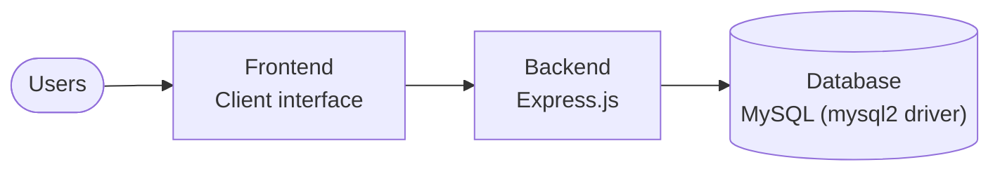
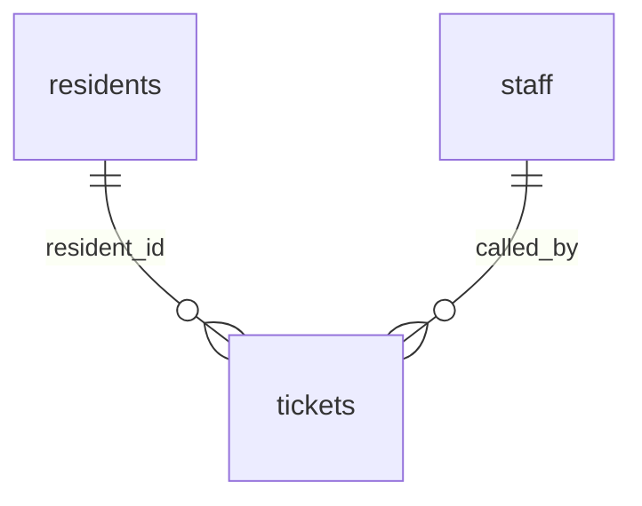

# AUTO-GENERATED FROM THE CODE

These sections come straight from the scan. Copy what you need into your chapters. Facts here were found in the repo; anything marked [STUDENT: ...] needs your input.

## Technology Stack (for Section 3.3)

| Technology | Version | Evidence in repo | Purpose |
|---|---|---|---|
| JavaScript | - | 3 source file(s) | [STUDENT: purpose] |
| SQL | - | 1 source file(s) | [STUDENT: purpose] |

| Framework / library | Layer | Package version (as declared) |
|---|---|---|
| Express.js | backend | ^4.19.0 |
| MySQL (mysql2 driver) | database | ^3.9.0 |
| bcrypt password hashing | security | ^5.1.1 |
| JSON Web Tokens | security | ^9.0.2 |
| Jest | testing | ^29.7.0 |

## System Architecture (for Section 3.2)

What the scan could not confirm about the tiers:

- The server tier is drawn because 5 route(s) are registered in this repo, not because a client URL points at it. Server-rendered apps look like this; if your client never reaches this code, say so and take the box out.

The layer names above come from packages the project declares, and a tier is only drawn when the client actually reaches it. [STUDENT: correct them if your system differs.]

## Modules and Endpoints (for Section 3.4)

### queue

| Method | Path | File |
|---|---|---|
| GET | /queue | routes/queue.js |
| POST | /queue | routes/queue.js |
| PUT | /queue/:id/call | routes/queue.js |

[STUDENT: describe what this module does for the user.]

### residents

| Method | Path | File |
|---|---|---|
| GET | /residents | routes/residents.js |
| POST | /residents | routes/residents.js |

[STUDENT: describe what this module does for the user.]

Top-level folders: `db`, `routes`, `tests`

## Database Design (for Section 3.7)

### Entity-Relationship Diagram

3 table(s) and 2 declared foreign-key relationship(s) were found. This figure shows entities and relationships only; every column is listed in the Data Dictionary below, which is the artifact your adviser grades. `diagrams/er_detail.mmd` keeps the full version in case you are asked for one.

### Data Dictionary

| Table | Column | Type | Key | Description |
|---|---|---|---|---|
| residents | id | INT | PK | [STUDENT: meaning] |
| residents | full_name | VARCHAR(100) | - | [STUDENT: meaning] |
| residents | address | TEXT | - | [STUDENT: meaning] |
| staff | id | INT | PK | [STUDENT: meaning] |
| staff | username | VARCHAR(50) | UNIQUE | [STUDENT: meaning] |
| staff | password_hash | VARCHAR(255) | - | [STUDENT: meaning] |
| tickets | id | INT | PK | [STUDENT: meaning] |
| tickets | resident_id | INT | FK -> residents | [STUDENT: meaning] |
| tickets | called_by | INT | FK -> staff | [STUDENT: meaning] |
| tickets | status | VARCHAR(20) | - | [STUDENT: meaning] |
| tickets | created_at | TIMESTAMP | - | [STUDENT: meaning] |

## Environment Settings (for Appendix B)

Read somewhere in the code but not declared in the example env file. A dependency or a build tool may be the one reading these, so check before listing them as your system's settings: `DB_HOST`, `JWT_SECRET`

## Tests Found (for Section 4.3.2)

1 file(s) inside the project's own test folders:

- `tests/queue.test.js`

These files exist. Run them yourself and paste the real output; do not report results you have not seen.

## Limitations Visible in the Code (for Section 4.5)

- `routes/queue.js:3` // TODO: add pagination
