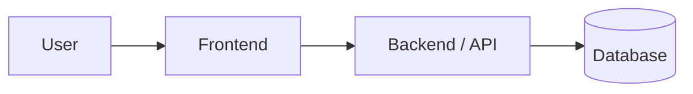
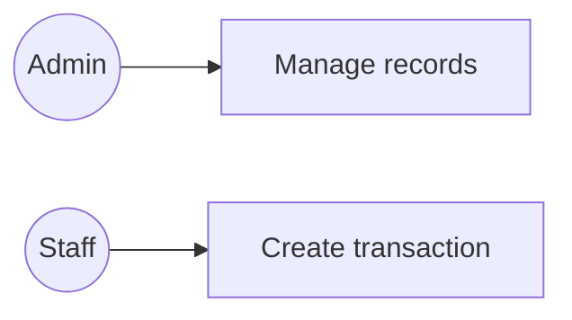
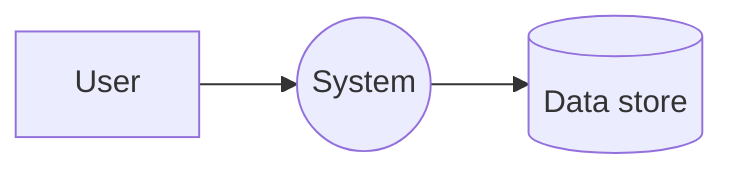
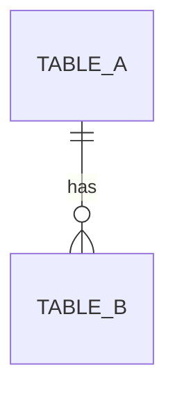

# CHAPTER 3
# METHODOLOGY

## 3.1 Software Development Model

The study used the {{SDLC model from intake}} model. [STUDENT: confirm, and name the real phases you followed with dates.]

| Phase | Activities done in this project |
|-------|--------------------------------|
| Planning | [STUDENT] |
| Analysis | [STUDENT: interviews, requirements gathered] |
| Design | {{from the repo: architecture, database, screens}} |
| Development | {{languages and frameworks from the scan}} |
| Testing | {{test files found, if any; otherwise: STUDENT}} |
| Deployment | {{hosting/config found, if any}} |

## 3.2 System Architecture

{{Describe layers found in the code: frontend, backend/API, database, external services.}}

[Use the architecture diagram from auto_sections.md, correcting the layer names.]

## 3.3 Technology Stack

| Layer | Technology | Version | Purpose |
|-------|-----------|---------|---------|
| {{from scan: language}} | | | |
| {{from scan: framework}} | | | |
| {{from scan: database}} | | | |
| {{from scan: key libraries}} | | | |

## 3.4 System Modules and Functions

For each module found in the code (routes, controllers, pages):

### 3.4.x {{Module name}}
- **Purpose:** {{one line}}
- **Users who access it:** {{roles from the code}}
- **Main functions:** {{list of actions the code actually performs}}

## 3.5 Use Case Diagram

[Replace actors and use cases with the real roles and features found in the code.]

## 3.6 Data Flow Diagram (Level 0 / Level 1)

[Draw Level 1 using the modules from 3.4.]

## 3.7 Database Design

### Entity-Relationship Diagram

[Paste the ER diagram from auto_sections.md. It uses the real table names and foreign keys.]

### Data Dictionary

| Table | Column | Type | Key | Description |
|-------|--------|------|-----|-------------|
| {{table}} | {{column}} | {{type}} | PK/FK | {{meaning, from code context}} |

## 3.8 Security and Access Control

{{Describe only what the code really implements: login method, password hashing, role checks, validation. Do not claim encryption or protection that is not in the repo.}}

## 3.9 Research Instrument and Evaluation Method

The system will be evaluated using a questionnaire based on ISO/IEC 25010 (see Appendix C).

- Respondents: [STUDENT: who and how many, e.g., 5 IT experts + 30 end users]
- Sampling method: [STUDENT]
- Scale: 5-point Likert (5 = Strongly Agree ... 1 = Strongly Disagree)
- Interpretation of mean: 4.21-5.00 Strongly Agree; 3.41-4.20 Agree; 2.61-3.40 Neutral; 1.81-2.60 Disagree; 1.00-1.80 Strongly Disagree
- Statistical tool: weighted mean

## 3.10 Ethical Considerations

[STUDENT: informed consent, data privacy (Data Privacy Act of 2012, RA 10173), confidentiality of respondents. Check your school's ethics requirements.]
